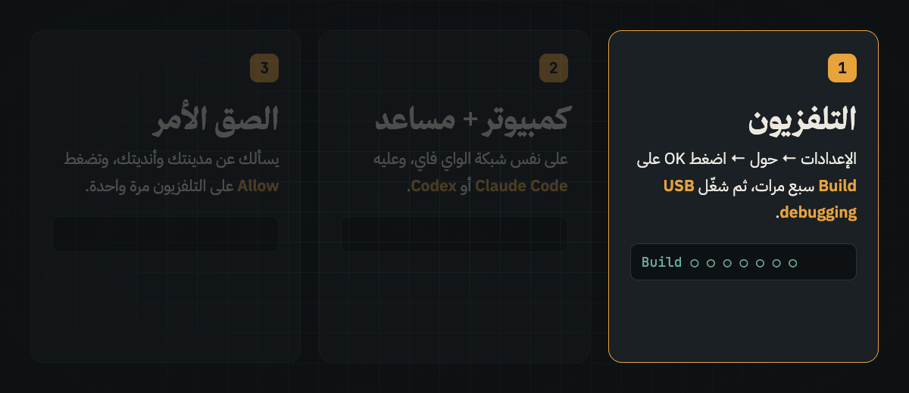

<p align="center"></p>

<p align="center" dir="rtl"><b>واجهة رئيسية عربية وشاشة توقّف سعودية لأجهزة Android TV و Google TV، مع تسريع آمن للتلفزيون — يركّبها لك مساعد ذكاء اصطناعي بأمر واحد.</b></p>

<p align="center"><b>An Arabic home screen and a Saudi screensaver for Android TV / Google TV, with a safe speed-up — installed for you by an AI coding agent with a single prompt.</b></p>

<p align="center"></p>

<p align="center"></p>

<p align="center"><a href="#العربية">العربية</a> · <a href="#english">English</a></p>

---

<a id="العربية"></a>
<div dir="rtl">

## 🇸🇦 التثبيت في 3 خطوات

### الخطوة 1 — جهّز التلفزيون

1. افتح **الإعدادات ← حول (About)**.
2. اضغط زر **OK** على خيار **Build** سبع مرات متتالية حتى تظهر رسالة «أصبحت مطوّرًا».
3. ارجع إلى **خيارات المطوّر (Developer options)** وفعّل **USB debugging**.

> تأكّد أن التلفزيون والكمبيوتر متصلان **بنفس شبكة الواي فاي**.

### الخطوة 2 — اختر مساعد الذكاء الاصطناعي على الكمبيوتر

| | **Claude Code** (Anthropic) ⭐ | **Codex** (OpenAI) |
|---|---|---|
| **التكلفة** | ضمن اشتراك Claude Pro أو Max | مجاني بحساب ChatGPT |
| **التحميل** | تطبيق Claude ← تبويب **Code**، أو من الطرفية | تطبيق Codex |
| **الصلاحيات** | اسمح للمهمة كاملة (انظر الشرح بالأسفل) | اختر «Approve for me» |

#### الطريقة (أ): Claude Code — موصى بها

**من تطبيق Claude (الأسهل):**
1. حمّل تطبيق Claude من [claude.ai/download](https://claude.ai/download) وسجّل الدخول.
2. افتح تبويب **Code** واختر مجلدًا فارغًا للعمل.
3. الصق الأمر الموجود في الخطوة 3.
4. عندما يطلب الإذن، اختر السماح للمهمة كلها حتى لا يتوقف أثناء التثبيت.

**أو من الطرفية (Terminal):**

```bash
# ماك / لينكس
curl -fsSL https://claude.ai/install.sh | bash

# ثم افتح مجلدًا فارغًا وشغّل:
mkdir caf-tv && cd caf-tv
claude
```

بعد التشغيل الصق الأمر من الخطوة 3. عند كل طلب إذن اختر **«Yes, and don't ask again»** للسماح بالأوامر المتكررة طوال الجلسة.

#### الطريقة (ب): Codex

1. حمّل تطبيق Codex وسجّل الدخول بحساب ChatGPT.
2. من الصلاحيات اختر **«Approve for me»**.
3. الصق الأمر من الخطوة 3.

> **مستخدمو ويندوز:** ركّبوا Git و Python أولًا:
> ```
> winget install Git.Git Python.Python.3.12
> ```
> Gemini CLI مجاني وأفاد بعض المستخدمين أنه يعمل، لكننا لم نختبره.

### الخطوة 3 — الصق هذا الأمر في المساعد

```text
ركّب تلفزيوني من https://github.com/iT-CAF/CAF-TV: انسخ المستودع واتبع docs/SETUP-PROMPT.md خطوة بخطوة. أنت على كمبيوتر متصل بنفس شبكة الواي فاي حقت التلفزيون.
```

### ماذا يحدث بعد ذلك؟

- يسألك المساعد عن **مدينتك** و**أنديتك المفضّلة**.
- يظهر على التلفزيون طلب **Allow** — وافق عليه مرة واحدة فقط.
- اترك المساعد يعمل: حوالي **40 دقيقة** مع عدة إعادات تشغيل للتلفزيون.

## ❓ أسئلة شائعة

| السؤال | الجواب | الأمر |
|---|---|---|
| أقدر أرجّع التلفزيون كما كان؟ | نعم، بأي وقت: تُحذف تطبيقاتنا، ويعود كل ما أطفأناه، وترجع الواجهة الأصلية. | `optimize/reset.sh` |
| نزل إصدار جديد؟ | حدّث التطبيقين وتبقى إعداداتك كما هي. الشاشة نفسها تتحدّث تلقائيًا، وخيار «تحديث الشاشة الآن» في الإعدادات ينبّهك عند وجود إصدار جديد. | `optimize/install.sh all` |
| تحديث النظام أوقف التطبيق؟ | أعد الإعداد كاملًا بأمر واحد، وتبقى إعداداتك محفوظة. | `optimize/run.sh again` |

> 💡 لا تحفظ الأوامر — قل للمساعد ببساطة: «رجّع التلفزيون كما كان» أو «حدّث كاف TV» وهو ينفّذ الأمر المناسب.

### 🔒 الأمان

- لا يُحذف أي تطبيق من النظام.
- لا نلمس **AirPlay** أو **Chromecast** أو **المساعد الصوتي** إطلاقًا.
- **مفتاح أمان لمدة 5 دقائق** يعيد الواجهة الأصلية تلقائيًا إذا لم تعمل واجهتنا.
- التطبيقات تُبنى وتُوقَّع عبر GitHub Actions من هذا المستودع مباشرة.

</div>

---

<a id="english"></a>

## 🇬🇧 Install in 3 steps

### Step 1 — Prepare the TV

1. Open **Settings → About**.
2. Press **OK** on **Build** seven times until you see "You are now a developer".
3. Go to **Developer options** and turn on **USB debugging**.

> Make sure the TV and your computer are on **the same Wi-Fi network**.

### Step 2 — Pick an AI agent on your computer

| | **Claude Code** (Anthropic) ⭐ | **Codex** (OpenAI) |
|---|---|---|
| **Cost** | Included with Claude Pro or Max | Free with a ChatGPT account |
| **Get it** | Claude app → **Code** tab, or the terminal | Codex app |
| **Approvals** | Allow for the whole task (see below) | Choose «Approve for me» |

#### Option A: Claude Code — recommended

**From the Claude app (easiest):**
1. Download the Claude app from [claude.ai/download](https://claude.ai/download) and sign in.
2. Open the **Code** tab and choose an empty working folder.
3. Paste the prompt from Step 3.
4. When asked for permission, allow it for the whole task so the setup doesn't pause midway.

**Or from the terminal:**

```bash
# macOS / Linux
curl -fsSL https://claude.ai/install.sh | bash

# then open an empty folder and run:
mkdir caf-tv && cd caf-tv
claude
```

Paste the prompt from Step 3. On each permission prompt, choose **"Yes, and don't ask again"** so repeated commands run without stopping.

#### Option B: Codex

1. Download the Codex app and sign in with your ChatGPT account.
2. Under approvals, choose **«Approve for me»**.
3. Paste the prompt from Step 3.

> **Windows users:** install Git and Python first:
> ```
> winget install Git.Git Python.Python.3.12
> ```
> Gemini CLI is free and reported to work, but we haven't tested it.

### Step 3 — Paste this prompt into the agent

```text
Set up my TV with https://github.com/iT-CAF/CAF-TV: clone it and follow docs/SETUP-PROMPT.md step by step. You are on a computer on the same Wi-Fi as the TV.
```

### What happens next?

- The agent asks for your **city** and your **favourite clubs**.
- The TV shows an **Allow** prompt — accept it once.
- Let it run: about **40 minutes**, with a few TV restarts.

## ❓ FAQ

| Question | Answer | Command |
|---|---|---|
| Can I undo everything? | Yes, anytime: our apps are removed, everything we turned off comes back, and the original home screen returns. | `optimize/reset.sh` |
| A new version is out? | Update both apps; all your settings stay. The screen updates itself, and the «Update screen now» row in settings tells you when a new version exists. | `optimize/install.sh all` |
| A TV system update locked our app out? | Redo the whole setup with one command, settings kept. | `optimize/run.sh again` |

> 💡 No need to memorise commands — just tell your agent "put my TV back to stock" or "update CAF TV" and it runs the right one.

### 🔒 Safety

- Nothing is uninstalled from the system.
- **AirPlay**, **Chromecast** and **voice** are never touched.
- A **5-minute safety switch** restores the stock home screen if ours doesn't come up.
- Apps are built and signed by GitHub Actions directly from this repo (version 3.N = build number).

Full prompt: [docs/SETUP-PROMPT.md](docs/SETUP-PROMPT.md) · Build a different screen: [docs/RECREATE-PROMPT.md](docs/RECREATE-PROMPT.md)

## What you get

| | | |
|---|---|---|
| **شاشة كاف** · screensaver | Clock, Hijri date, prayer times and iqama, Ramadan, your teams' matches, weather, markets, and beside the clock your choice of new episodes, today's prayers, the 5-day forecast, all your teams' games, or a verse/hadith of the day, over Saudi landscapes | `caftv-screensaver.apk` |
| **كاف TV** · home screen | Clean Arabic launcher: favourites row (5–10 apps) arranged in «ترتيب المفضلة», all apps, inputs, Wi-Fi, settings; optional card from the screensaver (off by default) | `caftv-home.apk` |
| **Two free apps** | [TV Bro](https://github.com/truefedex/tv-bro), a web browser for the TV, and [SmartTube](https://github.com/yuliskov/SmartTube), YouTube without ads, from their own releases (skip with `SKIP_EXTRAS=1`) | `optimize/install.sh extras` |
| **Speed-up** | Telemetry, ads and demos off (reversibly), closed apps frozen, Play Store kept from running in the background, faster animations | `optimize/` |

**Download the apps yourself:** [releases/apk-latest](https://github.com/iT-CAF/CAF-TV/releases/tag/apk-latest)
(install with `adb install`; the agent route above also sets everything up).
Every build is also kept as a numbered release (`v3.N`, the apps' version), to go back to one:
`APK_TAG=v3.N optimize/install.sh all`.

## For agents and scripts

Everything is scriptable over ADB, made for slow Wi-Fi (retries, resumable uploads, every step remembered):

| | |
|---|---|
| `optimize/find-tv.sh` | `--check`: can this terminal reach the home network at all (not from a cloud or sandbox) · then finds the TV (Windows, Mac, Linux) |
| `optimize/run.sh` | the whole setup; run again after any failure to continue · `status` · `again` after a TV system update (redo all, settings kept) |
| `optimize/saver.sh` | screensaver settings: `show`, `cities`, `city`, `find-team`, `teams`, `card`, `home-card`, `genres`, `langs`, `minrating`, `photos`, `idle`, `update` |
| `optimize/dock.sh` | favourites row: `show`, `apps`, `set`, `reset`; `hidden`, `hide PKG`, `show PKG` for apps left off the home screen |
| `optimize/measure.sh` · `shot.sh` | memory before/after (restart + settle) · screenshots without navigating |
| `optimize/keep.sh` | turn back on anything protected (AirPlay, casting, voice, updates…) that something turned off |
| `docs/TVS.md` | what was seen on each TV model (ADB port, home switch, what to watch out for) |
| `optimize/reset.sh` | back to stock: lists re-enabled, stock home and screensaver back, our apps removed |
| `optimize/share.sh` | if the owner wants: how the setup went (TV model, time per step, what failed, memory before/after; nothing personal), sent anonymously to the author (from their phone by a QR code if this computer is offline) |

What we learned on real TCL sets, and what must stay on: [docs/OPTIMIZE.md](docs/OPTIMIZE.md). Manual test plan:
[docs/TEST-PLAN.md](docs/TEST-PLAN.md).

## For developers

```
src/template.html the screen (HTML/CSS/JS, no framework); edit this, then run src/build.py
src/build.py builds the two pages in dist/
dist/caftv.html stand-alone page, fonts and photos inlined: open in any browser (F = full screen), works offline
dist/tv.html light page the Android app loads (0.3 MB); the app serves fonts and photos from disk
android/app the screensaver app (sa.urtv.screensaver): DreamService, settings, auto-update
android/launcher the home screen (sa.urtv.home)
assets/ fonts, bundled photos, Arabic team names, verse and hadith texts
photos/ the hosted photo set (5 shown per 4 days, rotating every 30 min)
optimize/ TV tools (Python ADB client, no adb binary needed); lists/ says what may be turned off
docs/ the agent prompts (setup, recreate), what we learned on real TVs, test plan, photo credits
.github/ CI: APK builds, checks, data tools (verses, hadith, clubs, photos), README images
tests/run.sh every check: build, data, fonts, scripts, private data, flaky-ADB upload, the screen in a browser
```

A push to `master` builds both APKs in GitHub Actions and publishes them to `apk-latest` and a numbered `v3.N`
release; a push to `next` publishes `apk-next` instead (a test build). `tests/run.sh` runs on `master`, `next`,
`content` and pull requests. Local Android build (needs the SDK): `python3 src/build.py && gradle -p android assembleRelease`
(signed with the debug key; the release key lives only in the repository's secrets).

**Screen settings** come from the URL fragment (works on `file://` and in WebView):

```
caftv.html#city=جدة&lat=21.5433&lon=39.1728&tz=Asia/Riyadh&teams=136013,136137&panel=prayers
```

`teams`: up to 10 TheSportsDB ids in priority order. `panel`: the card beside the clock: `shows`, `prayers`,
`forecast`, `matches`, `verse` or `none`. Also `genres`, `langs`, `shows`, `minrating` for the episodes card.

**Data** (free, no keys): Aladhan (prayer times, Umm al-Qura), Open-Meteo (weather), Yahoo and CoinGecko (markets),
TVMaze (episodes), TheSportsDB (matches). Everything fails soft: offline, the clock, dates, prayer and Ramadan
countdowns still work and the last good data stays on screen. A finished game's score stays up for a day.

**Verse and hadith texts are never typed by hand:** verses come from the Quran API via CI
(`.github/tools/fetch_verses.py`); each hadith is checked by CI (`.github/tools/verify_hadith.py`) against the
Arabic text of the six Sunni books, and only those found are shown, with the books as the source line.

**The Android apps** update the screen page from this repo every 6 hours (so it must stay public), start fast
(the page shows once the clock, saved panels and photo are ready), and come back after a power cut.

## Credits

CAF TV is built on [UrTV](https://github.com/tshi-dev/UrTV) by tshi-dev, redesigned with the iT CAF brand identity.

Photos: Unsplash photographers, listed in [docs/PHOTO-CREDITS.md](docs/PHOTO-CREDITS.md). Fonts: Thmanyah, and
Noto Naskh Arabic for ﷺ ﴿﴾ (OFL, `assets/fonts/`).
Home screen adapted from [mihirgupta0900/tv-home](https://github.com/mihirgupta0900/tv-home) (MIT,
`android/launcher/LICENSE-tv-home`). Package ratings from [UAD-ng](https://github.com/Universal-Debloater-Alliance/universal-android-debloater-next-generation).
